# Ore Lavoro — Manuale d'uso e di amministrazione

**Registro delle ore di lavoro e controllo dello stipendio**

Versione del manuale 1.0 · Ottobre 2026

<!-- pagebreak -->

<!-- toc -->

<!-- pagebreak -->

## 1. Informazioni sul documento

### 1.1 A chi è rivolto

Questo manuale accompagna **Ore Lavoro**, l'applicazione per registrare le ore di lavoro e verificare che lo stipendio ricevuto sia commisurato alle ore effettivamente lavorate. È organizzato per ruoli, così ognuno legge solo ciò che gli serve:

| Ruolo | Chi è | Capitoli da leggere |
|---|---|---|
| **Utente** | chi timbra le proprie ore e controlla lo stipendio | 2, 3, 4, 5, 11 |
| **Amministratore** (superadmin) | chi crea gli utenti, corregge i dati e gestisce l'app | 6, 7, 10 e tutto il resto |
| **Gestore tecnico** | chi installa, aggiorna e mantiene l'app sul NAS | 8, 9, 10, 11 e le appendici |
| **Sviluppatore** | chi modifica il programma | 12 e le appendici |

### 1.2 Convenzioni usate

> **Nota.** Un'informazione utile da sapere.

> **Suggerimento.** Un consiglio per lavorare meglio.

> **Attenzione.** Un'operazione che può causare perdita di dati o interruzioni: leggi prima di procedere.

I comandi da digitare in un terminale compaiono in riquadri grigi con il carattere a spaziatura fissa. Le parole **in grassetto** indicano pulsanti, voci di menu o nomi di campi così come li vedi sullo schermo. I valori da sostituire con i tuoi sono scritti in MAIUSCOLO (per esempio `NOME-DELLA-COPIA.db`).

### 1.3 Contenuto delle schermate

Tutte le schermate di questo manuale sono state ottenute con **dati inventati** (utenti Mario Rossi e Laura Bianchi) e non contengono informazioni reali.

<!-- pagebreak -->

## 2. Introduzione

### 2.1 Che cos'è Ore Lavoro

Ore Lavoro è un'applicazione web che permette di:

- **registrare le ore di lavoro** con un tocco ("Timbra entrata" e "Timbra uscita") oppure inserendo a mano data e orari;
- **sommare automaticamente** le ore di ogni giornata, anche quando il lavoro è interrotto da una pausa (più turni nello stesso giorno);
- **indicare ogni giorno del mese** come lavorato, ferie, malattia, permesso, festivo o riposo, in modo che il mese sia sempre completo;
- **confrontare lo stipendio con le ore**: inserendo lo stipendio netto (e, volendo, il lordo) l'applicazione calcola la **paga oraria effettiva**;
- **produrre report** mensili, sintetici o dettagliati, in PDF o Excel, da scaricare o ricevere per mail;
- **vedere l'andamento dell'anno** con grafici e tabelle;
- **continuare a funzionare anche senza rete**: se il server non è raggiungibile, le timbrature restano sul telefono e vengono inviate appena possibile.

È pensata per uso personale e familiare: ogni persona ha il proprio utente e il proprio PIN, e un amministratore può vedere e correggere i dati di tutti.

### 2.2 Concetti da conoscere

| Termine | Significato |
|---|---|
| **Turno** | un intervallo di lavoro con ora di inizio e di fine (per esempio 08:00 – 12:30). In un giorno puoi avere più turni. |
| **Ore della giornata** | la somma dei turni. Il tempo tra la fine di un turno e l'inizio del successivo (la pausa) **non viene contato**. |
| **Tipo di giornata** | come classificare il giorno: Lavoro, Ferie, Malattia, Permesso, Festivo o Riposo. |
| **Da compilare** | un giorno passato senza turni e senza tipo. Il mese è "completo" quando non ce ne sono. |
| **Paga oraria effettiva** | lo stipendio del mese diviso per le ore lavorate nel mese. |
| **Superadmin** | l'amministratore: crea gli utenti e può vedere e modificare i dati di chiunque. |
| **PIN** | il codice numerico (6-8 cifre) con cui ogni utente entra. |

### 2.3 Come funziona, in breve

L'applicazione ha due parti: il **server**, che gira in un contenitore (Docker) su un NAS o su un altro computer sempre acceso e conserva i dati, e l'**app**, che si apre dal browser del telefono o del computer. L'app può essere **installata** sul telefono come una normale applicazione (senza passare dagli store): si chiama *app web progressiva* o PWA.

```text
  Telefono / tablet / computer          Internet              NAS (Docker)
  ┌───────────────────────────┐   ┌─────────────────┐   ┌───────────────────────────┐
  │  App Ore Lavoro (PWA)     │──▶│ Cloudflare      │──▶│ Contenitore "orelavoro"   │
  │  - timbra, mese, report   │   │ Tunnel (HTTPS)  │   │  - server e database      │
  │  - coda offline sul       │   └─────────────────┘   │  - mail, copie notturne   │
  │    telefono               │                         │  Cartella dati sul NAS    │
  └───────────────────────────┘                         └───────────────────────────┘
```

> **Nota.** I dati restano sempre **sul tuo NAS**: non c'è nessun servizio esterno che li conserva. Cloudflare trasporta soltanto la connessione cifrata.

### 2.4 Requisiti

| Elemento | Requisito |
|---|---|
| Telefono | iPhone con iOS 16 o successivo (Safari), oppure Android con Chrome aggiornato |
| Computer | un browser moderno (Chrome, Edge, Firefox, Safari) |
| Server | un NAS Synology (o qualsiasi host Docker) con Container Manager e Portainer, sempre acceso |
| Rete | un tunnel Cloudflare (o altro modo di raggiungere il NAS da internet) per usare l'app fuori casa |
| Mail (facoltativa) | un server SMTP con autenticazione per report e promemoria |

<!-- pagebreak -->

## 3. Primi passi

### 3.1 Ottenere l'accesso

Il tuo amministratore ti crea un **utente** (per esempio `mario`) e ti comunica un **PIN** di 6-8 cifre e l'indirizzo dell'app (per esempio `https://ore.example.com`). Puoi cambiare il PIN in qualsiasi momento (vedi 4.9).

### 3.2 Accedere

Apri l'indirizzo dell'app, scrivi **Utente** e **PIN** e tocca **Entra**.

<p align="center">
  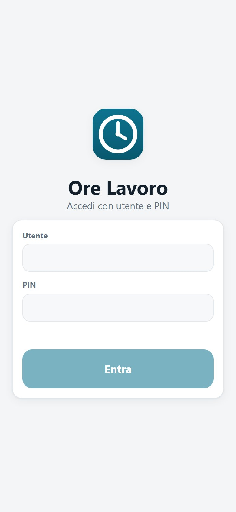
</p>

*Figura 1 — Schermata di accesso.*

- Dopo **5 tentativi con PIN errato** l'utente viene bloccato per **15 minuti**; l'amministratore può sbloccarlo subito (vedi 6.3).
- Una volta entrato, resti collegato per **60 giorni** dall'ultimo utilizzo.

### 3.3 Installare l'app sul telefono

Aprire l'app dal browser funziona, ma **installarla** è meglio: si apre a schermo intero, ha la sua icona e conserva meglio i dati della coda offline.

**iPhone e iPad**

1. Apri l'indirizzo dell'app in **Safari** (con altri browser non è possibile installarla).
2. Tocca **Condividi** (il quadrato con la freccia verso l'alto).
3. Scegli **Aggiungi alla schermata Home** e conferma.

**Android**

1. Apri l'indirizzo dell'app in **Chrome**.
2. Tocca il menu **⋮** in alto a destra e scegli **Installa app** (in alcune versioni: **Aggiungi a schermata Home**). In **Altro** trovi anche il pulsante **Installa ora**.

**Computer**

In Chrome o Edge clicca l'icona di installazione nella barra degli indirizzi: l'app si apre in una finestra tutta sua.

> **Attenzione (iPhone).** L'app installata dalla Home e Safari hanno **dati separati**: per l'app contano come due dispositivi diversi (vedi 5.3). Usa sempre l'icona sulla Home per timbrare.

### 3.4 Le schermate principali

Nella parte bassa del telefono (a sinistra sul computer) trovi cinque voci:

| Voce | A cosa serve |
|---|---|
| **Oggi** | timbrare entrata e uscita, vedere i turni di oggi, scegliere il tipo di giornata |
| **Mese** | l'elenco dei giorni del mese, con ore e stato di ciascuno |
| **Report** | inserire lo stipendio, vedere la paga oraria, scaricare i report |
| **Anno** | grafici e tabella dei 12 mesi |
| **Altro** | profilo, PIN, notifiche, tema, esportazione dati, amministrazione |

L'app si adatta allo schermo: su telefono le schede sono impilate, su computer compare la barra laterale e le informazioni si dispongono su due colonne.

<p align="center">
  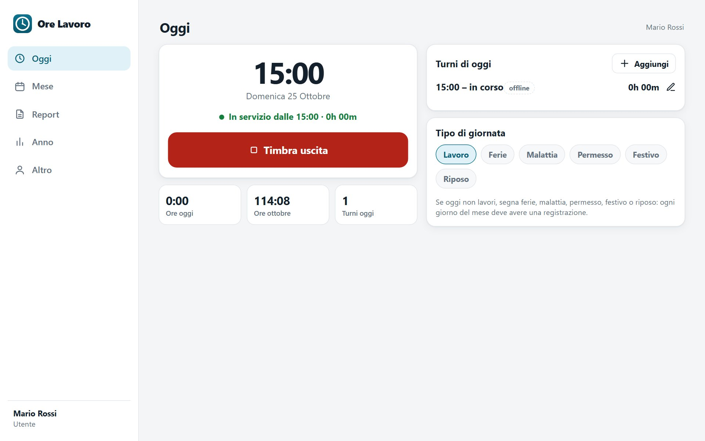
</p>

*Figura 2 — La schermata Oggi sul computer: barra laterale a sinistra, due colonne di contenuti.*

<!-- pagebreak -->

## 4. Uso quotidiano

### 4.1 Oggi: timbrare entrata e uscita

La schermata **Oggi** mostra l'orologio (con l'ora del server, in modo che sia sempre esatta), lo stato e il pulsante principale.

1. **Entrando al lavoro** tocca **Timbra entrata** (verde). Lo stato diventa "In servizio dalle HH:MM" con un contatore che scorre.
2. **Finito il turno** tocca **Timbra uscita** (rosso). Il turno viene chiuso e le ore si sommano.
3. Per la **pausa pranzo** timbra l'uscita e, al rientro, una nuova entrata: avrai due turni nella stessa giornata, e il tempo di pausa non sarà contato.

<p align="center">
  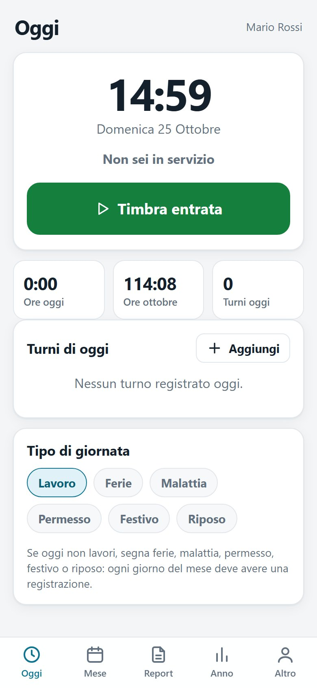
  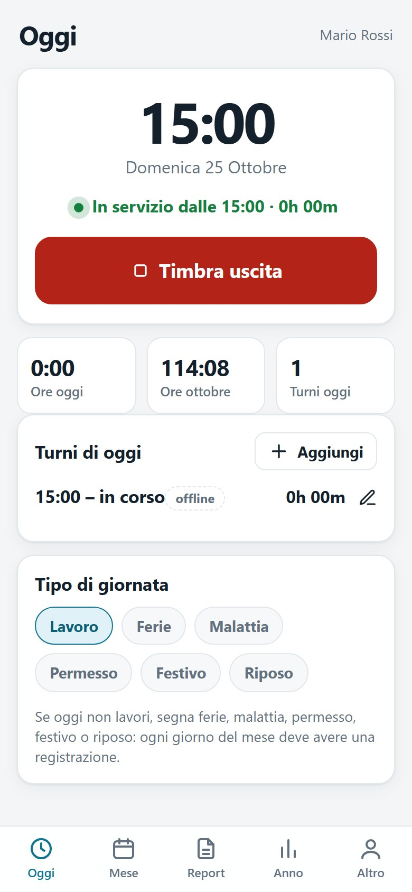
</p>

*Figura 3 — Oggi: a sinistra prima di timbrare, a destra dopo la timbratura di entrata.*

In basso trovi tre contatori: **Ore oggi**, le ore del mese (per esempio **Ore ottobre**) e **Turni oggi**. L'elenco **Turni di oggi** mostra ogni turno, e il pulsante **Aggiungi** permette di inserirne uno a mano.

> **Nota.** "Timbra" usa **l'ora del server**, non quella del telefono: anche se l'orologio del tuo telefono è sbagliato, la timbratura è esatta. Gli inserimenti a mano, invece, usano l'ora che scrivi tu.

**Cosa non puoi fare**

- Timbrare un'entrata se ne hai già una aperta, o un'uscita senza un'entrata aperta.
- Registrare ore che **non sono ancora iniziate** o orari nel futuro.
- Sovrapporre due turni: il secondo viene rifiutato con un messaggio che indica il turno in conflitto.
- Chiudere con un tocco un ingresso più vecchio di 24 ore: in quel caso l'app ti chiede di inserire tu l'ora di uscita.

**Turni a cavallo della mezzanotte.** Se inizi alle 22:00 e finisci alle 06:00, scrivi semplicemente 06:00 come fine: l'app capisce che è il giorno dopo e lo indica con "(+1)".

### 4.2 Avvisi nella schermata Oggi

In cima alla schermata compaiono, quando servono, avvisi colorati con un pulsante per risolvere:

| Avviso | Quando compare | Cosa fare |
|---|---|---|
| **Hai segnato l'ingresso … ma non l'uscita** (rosso) | un ingresso è rimasto aperto da un giorno precedente o da più di 12 ore | **Completa l'uscita**: scrivi l'ora in cui hai finito |
| **Turno molto lungo** | un turno degli ultimi 30 giorni supera le 12 ore | **Controlla**: probabilmente hai dimenticato l'uscita |
| **N giorni senza registrazione** | ci sono giorni passati, negli ultimi 7, senza turni né tipo | **Vai al mese** e compila i giorni mancanti |

> **Suggerimento.** L'app si aggiorna da sola quando la riapri o la riporti in primo piano: in questo modo il promemoria dell'uscita dimenticata compare appena guardi il telefono. Se hai attivato le notifiche via mail (vedi 4.9 e il capitolo 7), ricevi anche una mail.

### 4.3 Tipo di giornata

Ogni giorno del mese dovrebbe avere una registrazione. Quando **non lavori**, indica il motivo con i pulsanti **Tipo di giornata**:

| Tipo | Quando usarlo |
|---|---|
| **Lavoro** | giorno lavorato (non serve scegliere nulla: basta che ci siano dei turni) |
| **Ferie** | giorno di ferie |
| **Malattia** | giorno di malattia |
| **Permesso** | permesso (anche parziale: puoi avere un permesso e delle ore lavorate lo stesso giorno) |
| **Festivo** | festività infrasettimanale |
| **Riposo** | giorno di riposo |

Ferie, malattia, permessi e festivi sono conteggiati come **giorni**, non come ore lavorate: nel calcolo della paga oraria contano solo le ore effettivamente lavorate.

**Riposo automatico.** Se i tuoi giorni di riposo sono fissi (per esempio sabato e domenica), in **Altro → Giorni di riposo** puoi attivare *Proponi il riposo automaticamente* e scegliere i giorni: quelli vuoti non risulteranno "da compilare" e compaiono come **Riposo (auto)**. Se un giorno cambia, scegli un altro tipo solo per quel giorno.

### 4.4 Mese: l'elenco dei giorni

La schermata **Mese** mostra tutti i giorni del mese con ore, turni e stato. In alto: **Ore totali**, **Giorni lavorati** e **Da compilare**. Con le frecce cambi mese; toccando il nome del mese torni a quello corrente.

<p align="center">
  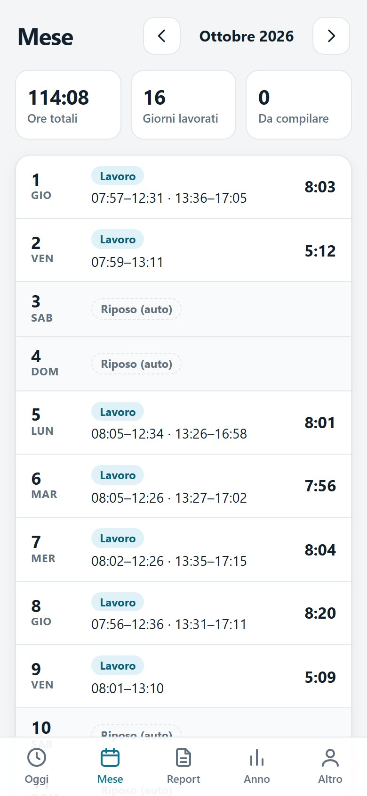
  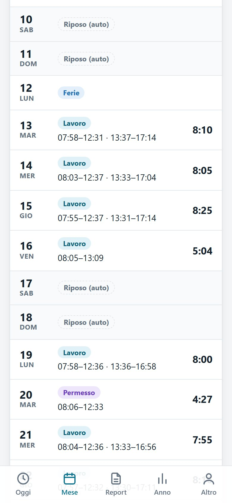
</p>

*Figura 4 — Il mese: a destra si vedono un giorno di ferie (12 ottobre) e un permesso (20 ottobre).*

Ogni riga ha un'etichetta:

| Etichetta | Significato |
|---|---|
| **Lavoro** (verde acqua) | giorno con almeno un turno |
| **Ferie / Malattia / Permesso / Festivo / Riposo** | tipo di giornata scelto |
| **Riposo (auto)** (tratteggiata) | riposo proposto dalle tue impostazioni |
| **Da compilare** (rossa tratteggiata) | giorno passato senza registrazione |
| **Oggi** | oggi, ancora senza registrazione |

I giorni futuri sono più sbiaditi. Se ci sono giorni "da compilare" compare il pulsante **Segna i giorni vuoti come riposo**, che li imposta in blocco (potrai poi correggerli uno a uno).

Una piccola scritta **⚠ da controllare** segnala giorni con un'anomalia: ingresso senza uscita, turno molto lungo o più di 14 ore in un giorno.

### 4.5 Il dettaglio di un giorno

Tocca un giorno per aprirne il dettaglio: puoi cambiare il **tipo di giornata**, vedere i **turni** e aggiungerne uno con **Aggiungi turno**.

<p align="center">
  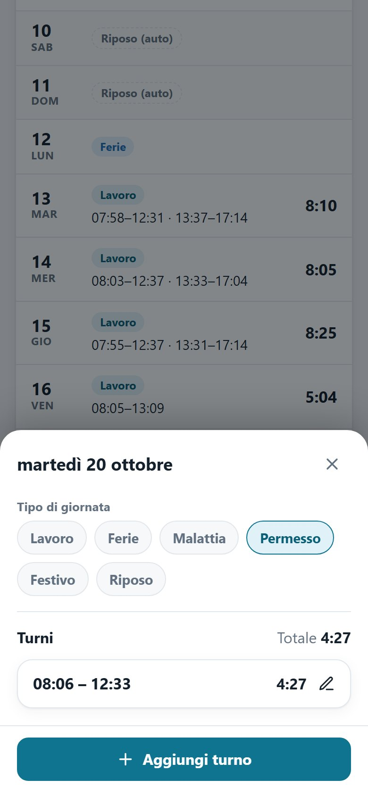
  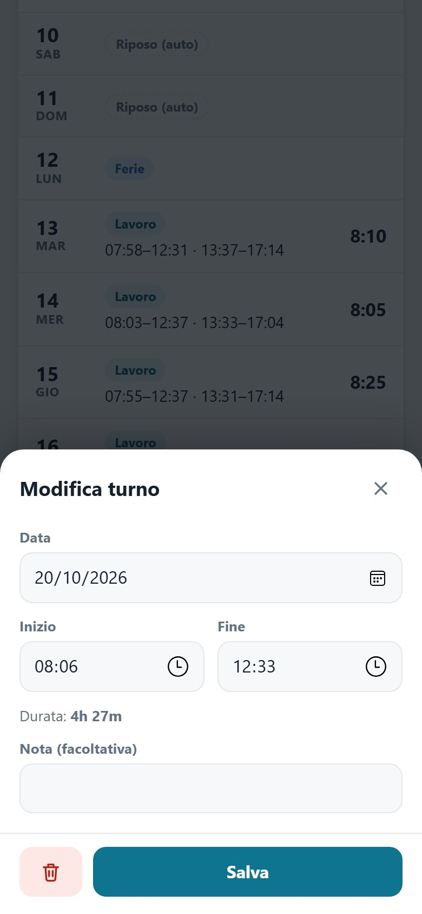
</p>

*Figura 5 — Il dettaglio del 20 ottobre (con permesso) e la modifica di un turno.*

### 4.6 Aggiungere, modificare ed eliminare un turno

- **Nuovo turno**: indica **Data**, **Inizio** e **Fine** (e, volendo, una **Nota**). Durante la digitazione vedi subito la **Durata**. Se lasci vuota la fine, il turno resta "in corso" e potrai completarlo più tardi.
- **Modifica**: tocca un turno, cambia i valori e **Salva**.
- **Elimina**: dentro la modifica tocca il pulsante rosso con il cestino.

**Conferma con il valore cambiato.** Prima di salvare una modifica o di eliminare un turno, l'app ti mostra che effetto avrà sul totale della giornata e ti chiede conferma:

<p align="center">
  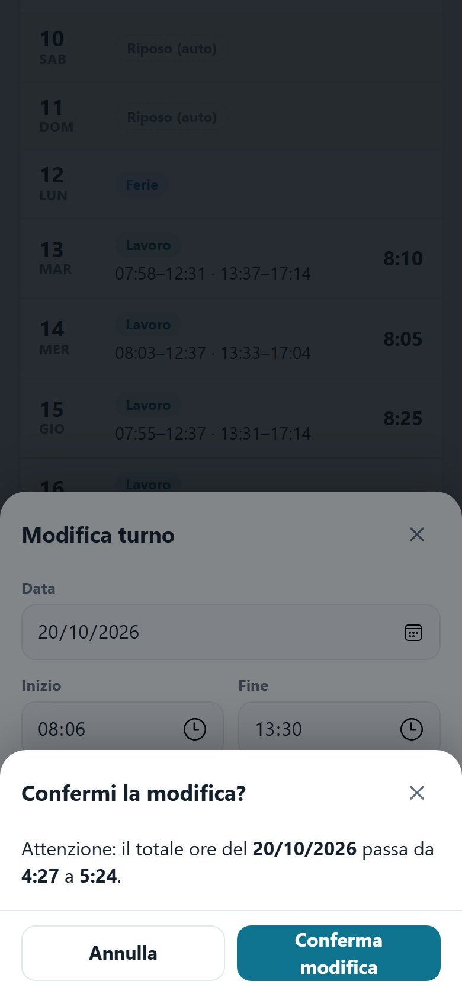
</p>

*Figura 6 — "Attenzione: il totale ore del 20/10/2026 passa da 4:27 a 5:24."*

Se la modifica sposta il turno su un altro giorno vedi il cambiamento di entrambi i giorni. Se il totale non cambia, l'app lo dice.

### 4.7 Stipendio e report

La schermata **Report** ("Stipendio e report") serve a verificare che lo stipendio sia commisurato alle ore.

1. Scegli il **mese** con le frecce.
2. In **Stipendio ricevuto** scrivi il **Netto in busta** (e, se vuoi, il **Lordo**). Puoi usare la virgola ("1.392,64") o il punto.
3. Tocca **Salva stipendio**.

Mentre scrivi, i riquadri azzurri mostrano subito la **Paga oraria netta** e, se hai inserito il lordo, la **Paga oraria lorda**:

> **Paga oraria = stipendio ÷ ore lavorate nel mese** (le ore sono quelle in decimali: 165:37 = 165,62 ore).

<p align="center">
  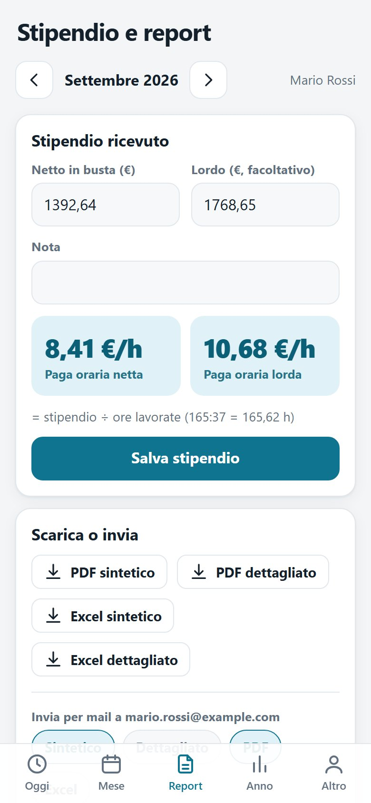
  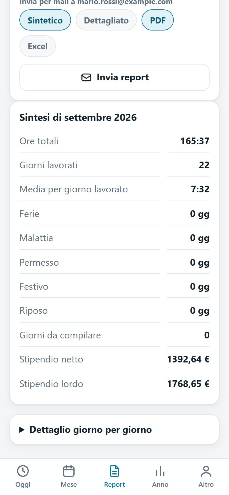
</p>

*Figura 7 — Stipendio di settembre: 1.392,64 € su 165:37 ore, cioè 8,41 € netti all'ora. A destra la sintesi del mese.*

Se il mese non è completo (giorni da compilare o ingressi senza uscita), compare un avviso: **la paga oraria è provvisoria** finché non completi il mese.

**Sintesi del mese.** Ore totali, giorni lavorati, media per giorno lavorato, giorni di ferie, malattia, permesso, festivo e riposo, giorni da compilare e stipendio. Con **Dettaglio giorno per giorno** vedi la tabella completa.

**Scaricare i report.** In **Scarica o invia** trovi quattro pulsanti:

| Pulsante | Contenuto |
|---|---|
| **PDF sintetico** | la sintesi del mese (ore, giorni, stipendio, paga oraria) |
| **PDF dettagliato** | la sintesi più la tabella di tutti i giorni con i turni |
| **Excel sintetico** | la sintesi in un foglio di calcolo |
| **Excel dettagliato** | sintesi e foglio con un giorno per riga (con totali) |

**Inviare il report per mail.** Se l'invio mail è attivo sul server, scegli **Sintetico/Dettagliato** e **PDF/Excel** e tocca **Invia report**: il file arriva all'indirizzo email del tuo profilo.

<p align="center">
  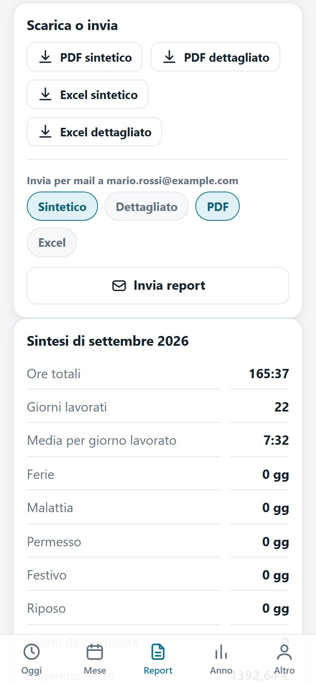
</p>

*Figura 8 — Scaricare o inviare per mail i report del mese.*

### 4.8 Anno: l'andamento dei 12 mesi

La schermata **Anno** mostra in alto le **ore dell'anno**, i **giorni lavorati** e la **paga oraria netta media**, poi due grafici (ore per mese e paga oraria netta per mese) e una tabella con ore, giorni, netto, lordo e paga oraria di ogni mese. Toccando il nome di un mese nella tabella apri quel mese.

<p align="center">
  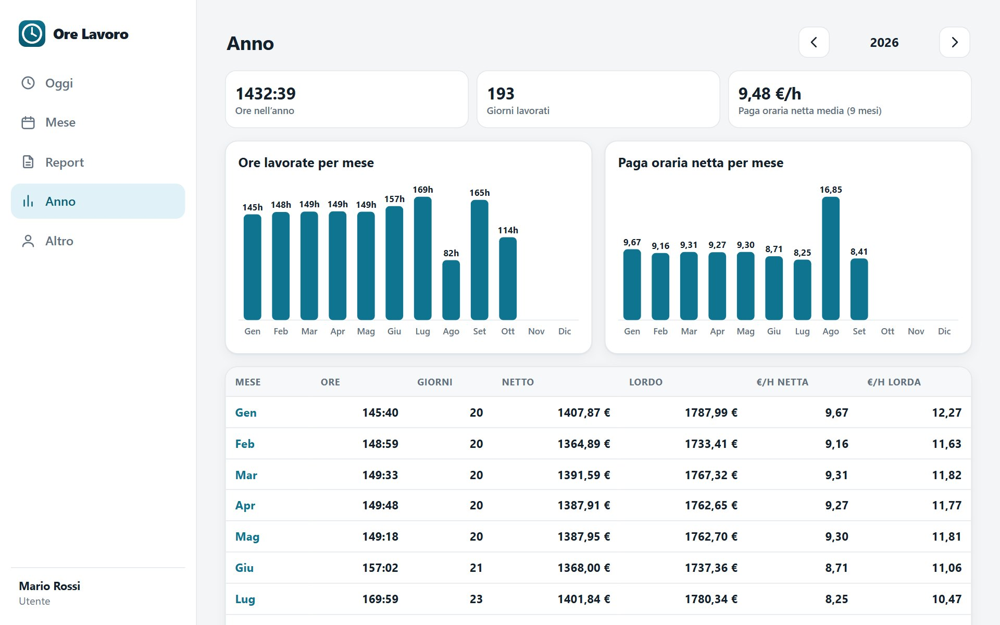
</p>

*Figura 9 — L'anno sul computer. Agosto, con meno ore lavorate a parità di stipendio, ha la paga oraria più alta.*

> **Nota.** I totali annuali di stipendio e di paga oraria considerano **solo i mesi per cui hai inserito lo stipendio**.

### 4.9 Altro: profilo, notifiche e preferenze

<p align="center">
  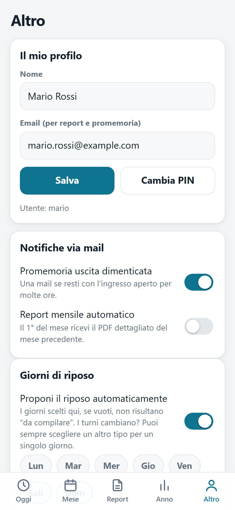
  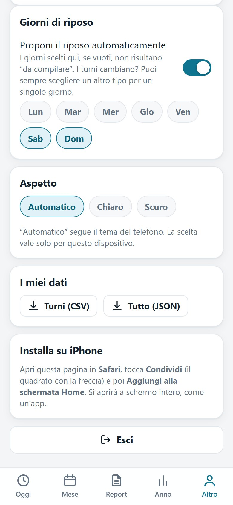
</p>

*Figura 10 — La pagina Altro.*

| Sezione | Cosa permette |
|---|---|
| **Il mio profilo** | cambiare **Nome** ed **Email** (serve per ricevere report e promemoria); **Cambia PIN** |
| **Notifiche via mail** | attivare il **promemoria di uscita dimenticata** e il **report mensile automatico** (vedi capitolo 7) |
| **Giorni di riposo** | attivare il riposo automatico e scegliere i giorni della settimana |
| **Aspetto** | tema **Automatico** (segue il telefono), **Chiaro** o **Scuro**, valido per il dispositivo in uso |
| **I miei dati** | scaricare i tuoi turni in **CSV** (apribile con Excel) o tutto in **JSON** |
| **Installa** | istruzioni per installare l'app (e, dove possibile, il pulsante **Installa ora**) |
| **Amministrazione** | solo per il superadmin (vedi capitolo 6) |
| **Esci** | disconnette questo dispositivo |

**Cambiare il PIN.** Tocca **Cambia PIN**, scrivi il PIN attuale e due volte il nuovo (6-8 cifre). Dopo il cambio, tutti gli altri dispositivi vengono scollegati.

<p align="center">
  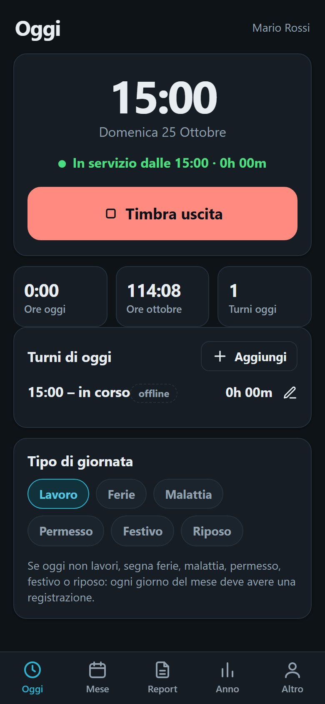
</p>

*Figura 11 — Il tema scuro.*

### 4.10 Come si calcolano le ore

- Le ore di una giornata sono la **somma dei turni**. Il tempo tra un turno e il successivo non conta.
- Il calcolo è **al minuto**, senza arrotondamenti. (Eventuali arrotondamenti previsti dal contratto non sono applicati dall'app.)
- Le durate sono **reali**: nelle due notti dell'anno in cui cambia l'ora legale, un turno a cavallo del cambio dura un'ora in più o in meno, come nella realtà.
- Un ingresso ancora **aperto** (senza uscita) non conta nelle ore finché non viene chiuso.
- La giornata appartiene al giorno in cui il turno **inizia**.

**Esempio.** Giovedì: 08:00–12:30 e 13:30–17:00. Ore della giornata = 4:30 + 3:30 = **8:00**. Nel mese le ore sono 165:37 (165,62 h) e lo stipendio netto 1.392,64 €: la paga oraria netta è 1.392,64 ÷ 165,62 = **8,41 €/h**.

<!-- pagebreak -->

## 5. Senza rete e con più dispositivi

### 5.1 Se il server non è raggiungibile

Può succedere che il NAS sia spento o in aggiornamento, che il tunnel sia interrotto o che tu non abbia campo. **Puoi timbrare lo stesso.**

- L'app si apre comunque (usa l'ultimo stato salvato) e mostra la barra **Server non raggiungibile: modalità offline**.
- Toccando **Timbra entrata** o **Timbra uscita**, la timbratura resta **sul telefono** con **l'ora del tocco** e compare nel riquadro **In attesa di invio**.
- Appena il server torna disponibile, le timbrature vengono inviate **in automatico, nell'ordine giusto e senza duplicati**. Quelle sincronizzate dopo compaiono con l'etichetta **offline**.

<p align="center">
  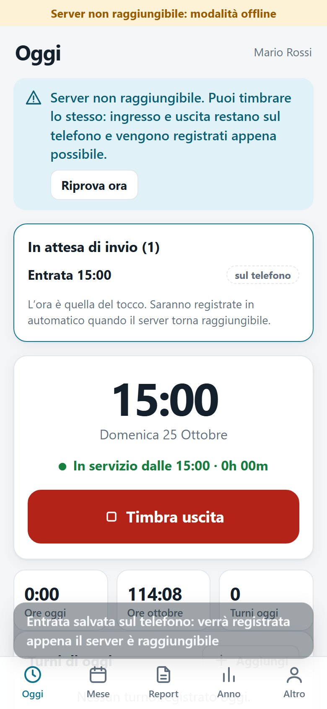
</p>

*Figura 12 — Senza rete: la timbratura è salvata sul telefono e aspetta di essere inviata.*

**Quando parte l'invio.** L'app controlla ogni 15 secondi se il server è tornato **mentre è aperta**. Su iPhone e Android un'app chiusa o ridotta a icona non può lavorare in background: le timbrature in attesa partono **la prossima volta che apri l'app**. Per questo, se vedi il riquadro "In attesa di invio", riapri l'app appena hai rete.

**Se qualcosa non può essere registrato.** Il server rifiuta una timbratura quando viola una regola (per esempio un'uscita senza ingresso, o due timbrature nello stesso minuto). In quel caso compare un riquadro rosso **Timbrature non registrate dal server** con il motivo e tre scelte:

| Pulsante | Effetto |
|---|---|
| **Inserisci a mano** | apre l'inserimento di un turno per quel giorno, così correggi tu l'orario |
| **Riprova** | rimette la timbratura in coda |
| **Scarta** | la elimina |

**Limiti da conoscere**

- Una timbratura offline viene accettata se non è più vecchia di **7 giorni**; oltre va inserita a mano.
- Finché è in coda esiste **solo sul telefono**: se cancelli i dati del sito o disinstalli l'app prima dell'invio, si perde. Sui dispositivi Apple, il sistema può cancellare i dati di un sito non usato per molto tempo: **apri l'app almeno una volta alla settimana** (l'app installata dalla Home è meno esposta).
- Il telefono con l'orologio sbagliato viene corretto con l'ora del server a ogni risposta ricevuta: la timbratura offline usa l'ora corretta.

### 5.2 Le modifiche non funzionano offline

Aggiungere, modificare o eliminare turni, cambiare il tipo di giornata e vedere mese, report e anno richiedono il server. Offline puoi **timbrare** e consultare l'ultima schermata **Oggi**.

### 5.3 Un solo dispositivo per utente

Per evitare conflitti, **un utente può essere collegato da un solo dispositivo alla volta**. Se accedi dal tablet, il telefono viene scollegato; al primo tocco mostra il motivo:

<p align="center">
  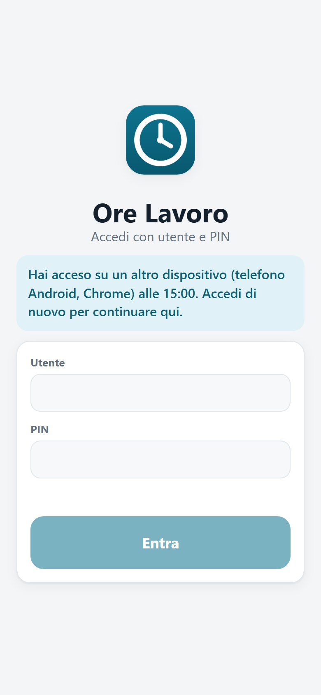
</p>

*Figura 13 — Il messaggio che compare sul dispositivo scollegato, con dispositivo, browser e ora dell'accesso.*

- Le timbrature ancora in coda sul dispositivo scollegato **non si perdono**: partono dopo il nuovo accesso.
- Se un secondo dispositivo mostra uno stato vecchio e provi a timbrare, il messaggio ti dice cosa è già successo: *"Hai già un ingresso aperto dalle 08:31 da iPhone: la pagina non era aggiornata."* oppure *"L'uscita risulta già registrata alle 12:30 da iPhone."*
- La schermata **Oggi** si aggiorna da sola ogni 30 secondi; le altre pagine quando riporti l'app in primo piano.

> **Nota.** L'app installata dalla Home di un iPhone e Safari sullo stesso iPhone contano come **due dispositivi**.

L'amministratore tecnico può disattivare questa regola impostando `SINGLE_SESSION=false` (vedi appendice A).

<!-- pagebreak -->

## 6. Guida dell'amministratore

L'amministratore (**superadmin**) vede in **Altro** la scheda **Amministrazione**. Il primo superadmin viene creato automaticamente durante l'installazione (vedi 8.4).

<p align="center">
  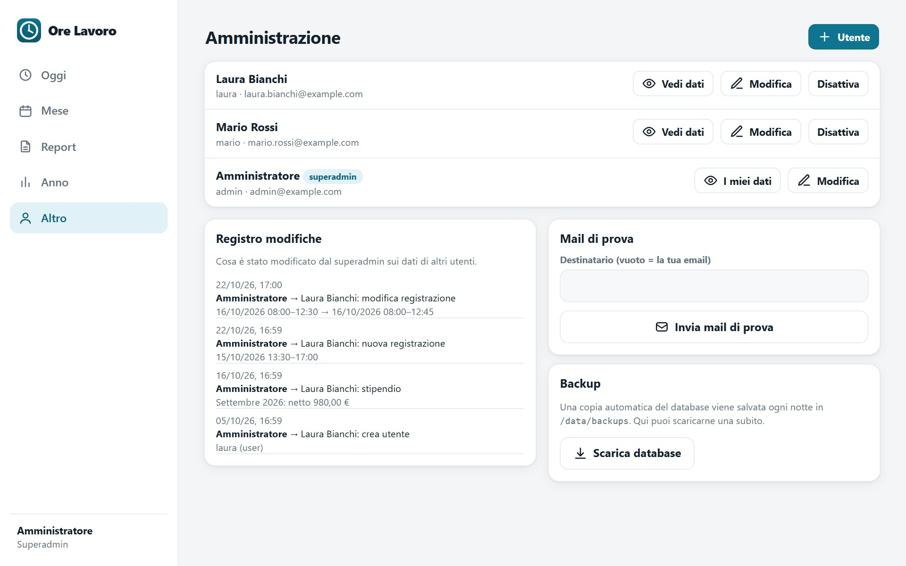
</p>

*Figura 14 — La pagina Amministrazione.*

### 6.1 Creare un utente

Tocca **+ Utente** e compila:

| Campo | Note |
|---|---|
| **Nome utente (per il login)** | 2-32 caratteri: lettere minuscole, numeri, punto, trattino, underscore. Non si può cambiare dopo |
| **Nome visualizzato** | il nome che appare nell'app |
| **Email** | per report e promemoria (facoltativa) |
| **PIN** | 6-8 cifre |
| **Ruolo** | **Utente** oppure **Superadmin** |

<p align="center">
  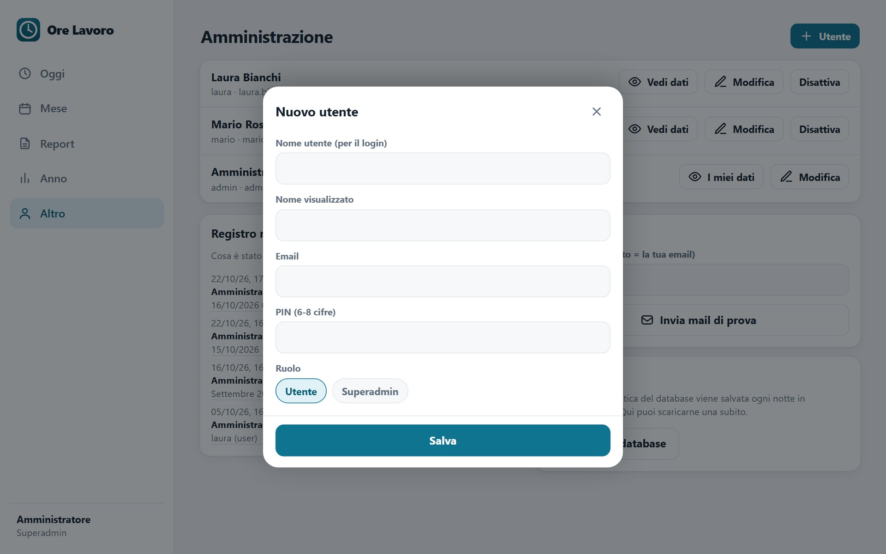
</p>

*Figura 15 — Creazione di un nuovo utente.*

> **Suggerimento.** Comunica il PIN di persona e invita l'utente a cambiarlo da **Altro → Cambia PIN**.

### 6.2 Modificare un utente, reimpostare il PIN, disattivare

Per ogni utente puoi:

- **Modifica**: cambiare nome, email e ruolo; inserendo un **nuovo PIN** lo reimposti (l'utente viene scollegato da tutti i dispositivi).
- **Disattiva / Riattiva**: un utente disattivato non può più entrare, ma i suoi dati restano. Non puoi disattivare né declassare te stesso.

### 6.3 Utente bloccato

Dopo 5 PIN errati l'utente è bloccato per 15 minuti e compare l'etichetta **bloccato**: tocca **Sblocca** per riattivarlo subito.

### 6.4 Vedere e correggere i dati di un utente

Con **Vedi dati** entri nei dati di quell'utente: in alto compare la barra **Stai vedendo i dati di …** e tutte le schermate (Oggi, Mese, Report, Anno) mostrano e **modificano** i dati di quella persona. Per tornare ai tuoi dati tocca **Torna ai miei**.

<p align="center">
  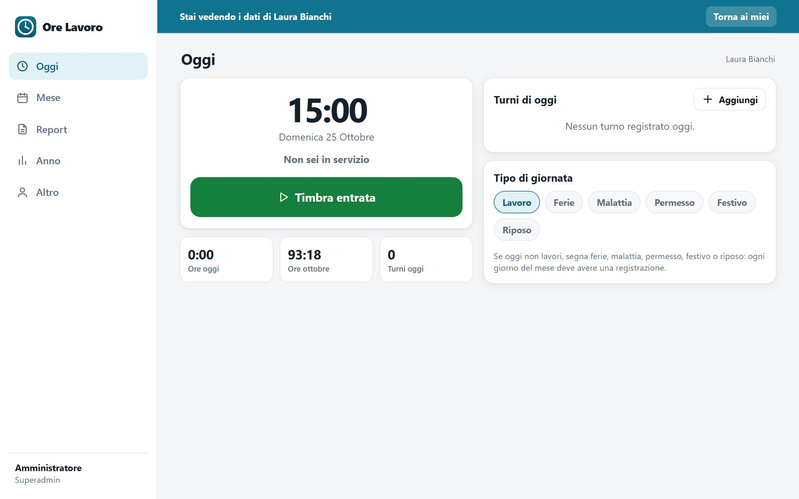
</p>

*Figura 16 — L'amministratore sta vedendo i dati di Laura Bianchi.*

> **Attenzione.** Le correzioni fatte sui dati di un'altra persona sono **registrate**: nessuna modifica avviene di nascosto (vedi 6.5).

### 6.5 Registro modifiche

Nel riquadro **Registro modifiche** trovi, dal più recente, tutto ciò che il superadmin ha cambiato sui dati degli altri: nuove registrazioni, modifiche, eliminazioni, tipo di giornata, stipendio, timbrature, creazione utenti, reimpostazione PIN. Ogni riga riporta data e ora, chi ha fatto cosa e il dettaglio.

### 6.6 Mail di prova e backup

- **Mail di prova**: scrivi un destinatario (o lascia vuoto per usare la tua email) e tocca **Invia mail di prova** per verificare la configurazione SMTP.
- **Backup → Scarica database**: scarica subito una copia completa del database (file `.db`). Conservala in un luogo sicuro: contiene gli stipendi.

## 7. Mail e notifiche

Per usare le mail il server deve avere un SMTP configurato (vedi 8.3 e appendice A). Senza SMTP l'app funziona uguale, ma i pulsanti di invio sono nascosti.

| Funzione | Quando | Destinatario |
|---|---|---|
| **Invia report** (da Report) | quando tocchi il pulsante | la tua email |
| **Report mensile automatico** | il **1° del mese**, dopo le 07:00 (fuso dell'app), con il PDF dettagliato del mese precedente | l'utente che lo ha attivato in **Altro** |
| **Promemoria uscita dimenticata** | quando un ingresso resta aperto da più di **12 ore** | l'utente che lo ha attivato; **una sola mail per ingresso** |
| **Mail di prova** | quando la richiedi dall'amministrazione | l'indirizzo che scegli |

**Attivarle.** In **Altro**, scrivi la tua **Email**, tocca **Salva** e poi attiva gli interruttori in **Notifiche via mail**.

> **Suggerimento.** Se le mail finiscono in spam, chiedi al gestore del dominio di configurare **SPF e DKIM** per il mittente usato dall'app.

<!-- pagebreak -->

## 8. Installazione e configurazione

Questo capitolo descrive l'installazione su un **NAS Synology con Portainer**, che è la configurazione di riferimento. Funziona su qualsiasi host con Docker.

### 8.1 Panoramica

L'applicazione è distribuita come **immagine Docker pubblica** su GitHub:

```text
ghcr.io/william-webext/orelavoro:latest
```

Ad ogni modifica del codice GitHub costruisce l'immagine (per processori Intel/AMD e ARM), che il NAS scarica quando aggiorni lo stack. I tag disponibili sono `latest` (ultima versione), `sha-XXXXXXX` (una versione precisa, utile per tornare indietro) e, per le versioni numerate, `1.2.3`.

### 8.2 Prima di iniziare

| Cosa | Dettaglio |
|---|---|
| **Pacchetto pubblico** | su GitHub: profilo → **Packages** → `orelavoro` → **Package settings** → **Change visibility** → **Public** (una volta sola), altrimenti il NAS non può scaricare l'immagine |
| **Cartella dati** | per esempio `/volume1/docker/orelavoro/data` (Docker la crea se manca) |
| **Utente del container** | via SSH, il comando `id` mostra uid e gid del tuo utente (di solito `1026` e `100` su Synology) |
| **Porta libera** | per esempio `3000` oppure `3010` se la 3000 è occupata (vedi 9.9) |
| **Tunnel Cloudflare** | già attivo sul NAS, con un dominio gestito da Cloudflare |
| **SMTP** | host, porta (587), utente e password, se vuoi le mail |

### 8.3 Creare lo stack in Portainer

1. In Portainer apri **Stacks → Add stack**, chiamalo `orelavoro` e scegli **Web editor**.
2. Incolla il testo seguente e sostituisci i valori:

```yaml
services:
  orelavoro:
    image: ghcr.io/william-webext/orelavoro:latest
    container_name: orelavoro
    restart: unless-stopped
    ports:
      - "3010:3000"                     # porta del NAS : porta interna (sempre 3000)
    volumes:
      - /volume1/docker/orelavoro/data:/data
    environment:
      PUID: "1026"
      PGID: "100"
      APP_TZ: Europe/Lisbon
      APP_URL: https://ore.example.com

      # superadmin: viene creato solo al primo avvio, a database vuoto
      SUPERADMIN_USER: admin
      SUPERADMIN_PIN: "CAMBIA"          # 6-8 cifre, non 123456
      SUPERADMIN_NAME: Amministratore
      SUPERADMIN_EMAIL: admin@example.com

      SMTP_HOST: smtp.example.com
      SMTP_PORT: "587"
      SMTP_USER: ore@example.com
      SMTP_PASS: "CAMBIA"               # password dell'utente SMTP
      SMTP_FROM: ore@example.com
```

3. Tocca **Deploy the stack**. Dopo circa 20 secondi il container `orelavoro` deve risultare **healthy** (in **Containers**).
4. Prova `http://IP-DEL-NAS:3010/api/health`: deve rispondere `{"ok":true}`.

> **Attenzione.** `SUPERADMIN_PIN` e `SMTP_PASS` restano scritti nello stack di Portainer: non copiarli mai nel repository o in chat. Il file `docker-compose.yml` presente nel repository usa invece variabili (`${NOME}`) e non contiene dati personali.

> **Nota.** La porta a destra dei due punti (`3000`) è quella **interna** e non va cambiata. Se la porta del NAS è occupata cambia solo il numero a sinistra.

### 8.4 Il primo accesso e il superadmin

Il superadmin è creato **solo al primo avvio con il database vuoto**, con `SUPERADMIN_USER` e `SUPERADMIN_PIN`. Dopo, quelle variabili non servono più e puoi toglierle dallo stack. Se vuoi un altro PIN usa il comando di reimpostazione (vedi 9.8). Entra con quell'utente, poi crea gli altri utenti da **Altro → Amministrazione**.

### 8.5 Pubblicare l'app in internet con Cloudflare Tunnel

L'app non richiede di aprire porte sul router: il tunnel esce dal NAS verso Cloudflare.

1. Apri **one.dash.cloudflare.com** (Zero Trust) → **Networks → Tunnels**.
2. Scegli il tuo tunnel (deve essere **Healthy**) → **Configure** → scheda **Public Hostname** (o *Published application routes*) → **Add**.
3. Compila:

| Campo | Valore |
|---|---|
| Subdomain | `ore` |
| Domain | il tuo dominio (per esempio `example.com`) |
| Path | vuoto |
| Service type | **HTTP** |
| URL | `IP-DEL-NAS:3010` (senza `http://`) |

4. Salva: Cloudflare crea da solo il record DNS. Se risponde "A record already exists", cancella il record `ore` esistente nella sezione **DNS** e riprova.
5. Prova da un telefono **senza Wi-Fi**: `https://ore.example.com/api/health` deve rispondere `{"ok":true}`.

Se `cloudflared` gira anch'esso in un container, usa come URL l'**indirizzo IP del NAS** e non `localhost`.

> **Suggerimento.** Per un livello di protezione in più si può mettere Cloudflare Access davanti al dominio. È facoltativo: l'app ha già blocco dopo i tentativi errati e PIN a 6-8 cifre.

### 8.6 Verifiche finali

- [ ] `https://ORE.TUO-DOMINIO/api/health` risponde `{"ok":true}` da fuori casa
- [ ] accedi con il superadmin e crei un utente di prova
- [ ] **Amministrazione → Invia mail di prova** arriva (se hai configurato SMTP)
- [ ] installi l'app sul telefono dalla Home
- [ ] **Amministrazione → Scarica database** funziona
- [ ] pianifichi il backup sul NAS (vedi 9.3)

### 8.7 Installazione con Docker senza Portainer

Con Docker Compose basta salvare il file seguente come `docker-compose.yml`, un file `.env` accanto con i valori, e lanciare `docker compose up -d`:

```yaml
services:
  orelavoro:
    image: ghcr.io/william-webext/orelavoro:latest
    container_name: orelavoro
    restart: unless-stopped
    ports:
      - "3000:3000"
    volumes:
      - ./data:/data
    environment:
      PUID: ${PUID:-1000}
      PGID: ${PGID:-1000}
      APP_TZ: ${APP_TZ:-Europe/Lisbon}
      APP_URL: ${APP_URL:-}
      SUPERADMIN_USER: ${SUPERADMIN_USER:-}
      SUPERADMIN_PIN: ${SUPERADMIN_PIN:-}
      SMTP_HOST: ${SMTP_HOST:-}
      SMTP_USER: ${SMTP_USER:-}
      SMTP_PASS: ${SMTP_PASS:-}
      SMTP_FROM: ${SMTP_FROM:-}
```

<!-- pagebreak -->

## 9. Manutenzione

### 9.1 Calendario di manutenzione

| Frequenza | Operazione | Dove |
|---|---|---|
| **Ogni giorno** | nulla: le copie notturne e il controllo dei promemoria sono automatici | — |
| **Ogni settimana** | aprire l'app da ogni telefono (svuota le code offline e tiene vivi i dati) | telefoni |
| **Ogni mese** | controllare che il backup del NAS sia stato creato e che le attività pianificate siano riuscite | DSM → Pianificazione attività |
| **Ogni mese** | vedere se è uscita una nuova versione dell'app e aggiornare (9.2) | GitHub / Portainer |
| **Ogni mese** | controllare lo spazio libero sul volume | DSM → Gestione archiviazione |
| **Ogni 3-6 mesi** | fare una **prova di ripristino** su una cartella di prova (9.7) | NAS |
| **Ogni anno** | rivedere gli utenti attivi, i PIN e l'indirizzo mail dell'amministratore | Amministrazione |

### 9.2 Aggiornare l'app

1. Controlla su GitHub (pagina **Actions** del repository) che l'ultima esecuzione sia **verde**: significa che l'immagine nuova è pronta.
2. In Portainer apri **Stacks → orelavoro**.
3. Attiva **Re-pull image** e tocca **Update the stack**.
4. Verifica che il container diventi **healthy** e che `/api/health` risponda.
5. Sui telefoni: apri l'app **a server acceso** una volta, chiudila del tutto e riaprila: così scarica la versione nuova.

Se la nuova versione cambia la struttura del database, all'avvio succede da sola la **migrazione con copia preventiva** (vedi 9.4). I dati restano nella cartella `/data`.

**Tornare a una versione precedente.** Nello stack sostituisci `:latest` con il tag di una versione funzionante (per esempio `:sha-a2cdabc`, visibile nella pagina **Packages** del repository) e aggiorna lo stack. Se la versione più recente aveva già migrato il database, ripristina anche la copia preventiva (9.5), perché un'app più vecchia non accetta un database più nuovo e lo segnala con un messaggio nei log.

### 9.3 Backup: tre livelli di protezione

| Livello | Chi lo fa | Dove | Cosa protegge |
|---|---|---|---|
| **1. Copia notturna interna** | l'app, dopo le 03:00 | `/data/backups/orelavoro_AAAA-MM-GG.db` (ultime 14) | errori e cancellazioni recenti |
| **2. Copia del NAS** | un'attività pianificata di DSM | per esempio `/volume1/docker/backup/orelavoro/orelavoro_DATA.tar.gz` (ultimi 7 giorni) | cartella dati persa o danneggiata |
| **3. Copia fuori dal NAS** | Hyper Backup | disco esterno o cloud | guasto o perdita del NAS |

> **Attenzione.** I livelli 1 e 2 stanno sullo **stesso disco** del NAS: non proteggono da un guasto del disco. Configura anche il livello 3 sulla cartella `/volume1/docker/backup/orelavoro` (e, meglio, su tutta `/volume1/docker/orelavoro`).

**Configurare il livello 2 (attività pianificata di DSM)**

1. **Pannello di controllo → Pianificazione attività → Crea → Attività pianificata → Script definito dall'utente**.
2. Utente **root**; pianificazione **ogni giorno dopo le 03:30** (così include la copia notturna interna).
3. In **Impostazioni attività** incolla lo script dell'appendice C (si trova anche nel repository: `scripts/backup-nas.sh`).
4. Attiva **Invia i dettagli di esecuzione via e-mail** con **solo in caso di terminazione anomala**: lo script termina con errore (codice 1) se qualcosa non va.
5. Premi **Esegui** una volta e controlla che compaia il file `.tar.gz`.

Lo script mette in pausa il container solo per il tempo della copia (così il database non viene copiato a metà scrittura), verifica che l'archivio sia leggibile, e cancella i file più vecchi di 7 giorni **solo se** la copia è riuscita.

**Scaricare un backup a mano.** **Altro → Amministrazione → Scarica database** scarica una copia subito.

### 9.4 Aggiornamenti del database (migrazioni) e copia preventiva

Quando un aggiornamento cambia la struttura del database, all'avvio l'app applica la **migrazione** con queste garanzie:

1. **Copia preventiva** completa e **verificata**: `/data/backups/pre-migrazione_vX-vY_AAAA-MM-GGTHH-MM-SS-mmm.db` (si conservano le ultime 10). Se la copia non riesce, la migrazione **non parte**.
2. **Tutto o niente**: tutte le modifiche avvengono in un'unica transazione, con controlli di integrità prima di confermarla. Se qualcosa va storto il database resta **esattamente com'era** e l'app si ferma con un messaggio chiaro nei log (righe che iniziano con `[db]`).
3. **Database più nuovo dell'app** (per esempio dopo aver rimesso un'immagine vecchia): non viene toccato; l'app si ferma e spiega perché.
4. Se l'app riparte più volte dopo un errore non si riempie il disco di copie identiche.

Il messaggio di una migrazione riuscita nei log è del tipo:

```text
[db] migrazione dello schema v3 → v4 completata. Copia preventiva: /data/backups/pre-migrazione_v3-v4_….db
```

### 9.5 Ripristinare il database

Esistono tre situazioni tipiche.

**A. L'app non parte dopo un aggiornamento** (log con `[db] Migrazione del database fallita…`). Il database **non è stato modificato**: non devi ripristinare nulla. Torna all'immagine precedente (9.2) oppure attendi la correzione, poi aggiorna di nuovo.

**B. L'app funziona ma vuoi tornare a prima di un aggiornamento o di un errore.**

1. In Portainer: **Stacks → orelavoro → Stop**.
2. Via SSH sul NAS, elenca le copie e ripristina quella voluta (usa gli stessi `PUID`/`PGID` dello stack):

```bash
docker run --rm -e PUID=1026 -e PGID=100 \
  -v /volume1/docker/orelavoro/data:/data \
  ghcr.io/william-webext/orelavoro:latest \
  node src/server/cli.ts list-backups

docker run --rm -e PUID=1026 -e PGID=100 \
  -v /volume1/docker/orelavoro/data:/data \
  ghcr.io/william-webext/orelavoro:latest \
  node src/server/cli.ts restore NOME-DELLA-COPIA.db
```

3. **Stacks → orelavoro → Start**. Se la copia ripristinata è di una versione più vecchia dello schema, viene migrata di nuovo (con una nuova copia preventiva).

Il comando `restore`:

- rifiuta di lavorare se il database è in uso (il container va fermato);
- controlla che la copia sia un database valido e non vuoto;
- **salva il database attuale** in `/data/backups/prima-del-ripristino_….db`, così anche il ripristino si può annullare.

**Senza riga di comando.** Con lo stack fermo, da File Station copia la copia scelta sopra `orelavoro.db` e **cancella** `orelavoro.db-wal` e `orelavoro.db-shm` (se esistono). Poi riavvia.

**C. La cartella dati è andata persa** (disco guasto, cartella cancellata). Ripristina dall'archivio del NAS o da Hyper Backup:

```bash
# fermare lo stack, poi:
cd /volume1/docker/orelavoro
mv data data_danneggiata 2>/dev/null
tar -xzf /volume1/docker/backup/orelavoro/orelavoro_AAAA-MM-GG_HHMM.tar.gz   # ricrea la cartella "data"
# riavviare lo stack
```

### 9.6 Elenco e uso delle copie

```bash
docker exec -it orelavoro node src/server/cli.ts list-backups
```

L'elenco indica data, dimensione e tipo di ogni copia: **notturna**, **prima di una migrazione** o **prima di un ripristino**.

| Nome del file | Cosa contiene |
|---|---|
| `orelavoro_AAAA-MM-GG.db` | copia notturna automatica (ultime 14) |
| `pre-migrazione_vX-vY_….db` | database com'era **prima** di passare dalla versione X alla Y dello schema (ultime 10) |
| `prima-del-ripristino_….db` | database com'era **prima** di un ripristino |

### 9.7 Prova di ripristino su una cartella di prova (consigliata)

Una copia che non si è mai provato a ripristinare è una copia di cui non ci si può fidare. Per provarla **senza toccare l'app in produzione**:

```bash
# 1) cartella di prova con una copia
mkdir -p /volume1/docker/orelavoro-prova/data
cp /volume1/docker/orelavoro/data/backups/orelavoro_AAAA-MM-GG.db /volume1/docker/orelavoro-prova/data/orelavoro.db

# 2) avvio di una seconda istanza su un'altra porta (3011)
docker run --rm -p 3011:3000 -e PUID=1026 -e PGID=100 \
  -v /volume1/docker/orelavoro-prova/data:/data \
  ghcr.io/william-webext/orelavoro:latest
```

Apri `http://IP-DEL-NAS:3011`, accedi con un utente esistente e controlla che i dati ci siano. Poi ferma il container (Ctrl+C) e cancella `/volume1/docker/orelavoro-prova`.

### 9.8 Comandi di servizio (PIN, utenti)

Si eseguono con il container acceso:

```bash
# elenco utenti
docker exec -it orelavoro node src/server/cli.ts list-users

# reimpostare il PIN di un utente (e scollegarlo ovunque)
docker exec -it orelavoro node src/server/cli.ts reset-pin NOMEUTENTE 123456

# elenco delle copie del database
docker exec -it orelavoro node src/server/cli.ts list-backups
```

In Portainer: **Containers → orelavoro → Console → Connect** (shell `/bin/sh`), poi gli stessi comandi senza `docker exec -it orelavoro`.

> **Nota.** Se hai perso l'accesso del superadmin e non ricordi il PIN, `reset-pin` è la via di recupero.

### 9.9 Log e controllo dello stato

| Cosa vuoi sapere | Comando o percorso |
|---|---|
| Il container è acceso? | `docker ps --filter name=orelavoro` |
| È in salute? | `docker inspect --format '{{.State.Health.Status}}' orelavoro` (deve dire `healthy`) |
| Cosa scrive l'app? | `docker logs --tail 100 -f orelavoro` (Portainer: **Containers → orelavoro → Logs**) |
| Risponde dall'esterno? | aprire `https://ORE.TUO-DOMINIO/api/health` |
| Quanta memoria usa? | `docker stats orelavoro --no-stream` |
| Quali porte sono occupate? | Portainer → **Containers** → colonna **Published Ports**, oppure `docker ps --format "table {{.Names}}\t{{.Ports}}"` |

**Righe dei log da conoscere**

| Riga | Significato |
|---|---|
| `Ore Lavoro in ascolto su http://localhost:3000 …` | l'app è partita |
| `[setup] Creato superadmin "…"` | primo avvio, superadmin creato |
| `[setup] Nessun utente presente: imposta SUPERADMIN_USER e SUPERADMIN_PIN` | database vuoto senza superadmin: aggiungi le variabili |
| `[db] migrazione dello schema vX → vY completata` | aggiornamento del database riuscito |
| `[db] Migrazione del database fallita …` | migrazione annullata, database intatto |
| `[backup] creato orelavoro_…db` | copia notturna fatta |
| `[mail] promemoria uscita inviato a …` / `[mail] report … inviato a …` | mail automatica spedita |
| `[mail] invio report fallito` / `test fallito` | problema SMTP (vedi capitolo 10) |
| `[errore] …` | errore interno: conserva la riga e il contesto |

### 9.10 Spazio su disco e pulizia

La cartella dati contiene il database (pochi MB), le copie notturne (14), le copie preventive (10 al massimo) e i file temporanei di SQLite (`orelavoro.db-wal` e `-shm`, che non vanno cancellati finché il container è acceso). Per liberare spazio basta cancellare le copie più vecchie da `/data/backups`; **non cancellare mai** `orelavoro.db`.

### 9.11 Cambiare porta, dominio o fuso orario

| Cosa | Come |
|---|---|
| **Porta del NAS** | nello stack cambia il numero a sinistra in `ports` (per esempio `"3011:3000"`), aggiorna lo stack e correggi l'URL nel tunnel Cloudflare |
| **Dominio** | cambia l'hostname nel tunnel e `APP_URL` nello stack; ogni telefono deve rifare l'accesso e reinstallare l'app dal nuovo indirizzo |
| **Fuso orario** | cambia `APP_TZ` (per esempio `Europe/Rome`); influisce sull'ora di "Timbra ora", sui report, sull'ora delle copie e delle mail automatiche |

### 9.12 Spostare l'app su un altro NAS

1. Sul vecchio NAS: ferma lo stack e copia la cartella `data` (almeno `orelavoro.db`).
2. Sul nuovo NAS: crea la cartella `…/orelavoro/data` e metti dentro `orelavoro.db` (nessun file `-wal`/`-shm`).
3. Crea lo stack (8.3) con gli stessi `PUID`/`PGID` del nuovo NAS: i **superadmin e gli utenti esistenti restano**, quindi `SUPERADMIN_*` non servono.
4. Aggiorna il tunnel Cloudflare perché punti al nuovo NAS.
5. Sui telefoni basta riaprire l'app: dovranno solo rifare l'accesso.

### 9.13 Disinstallare

1. Scarica un'ultima copia (**Scarica database**) e i report che ti servono.
2. In Portainer: **Stacks → orelavoro → Delete this stack**.
3. Elimina l'hostname dal tunnel Cloudflare e, se vuoi, la cartella `/volume1/docker/orelavoro`.

## 10. Sicurezza e privacy

### 10.1 Come sono protetti gli accessi

| Misura | Dettaglio |
|---|---|
| **PIN** | 6-8 cifre, conservato come impronta con l'algoritmo **scrypt** (non in chiaro) |
| **Blocco** | 5 PIN errati bloccano l'utente per 15 minuti; in più c'è un limite di tentativi per indirizzo di rete |
| **Sessione** | cookie `HttpOnly`, `SameSite=Lax` e `Secure` (via HTTPS); dura 60 giorni dall'ultimo uso |
| **Un solo dispositivo** | un nuovo accesso scollega il precedente |
| **Controllo dell'origine** | le richieste che modificano i dati devono arrivare dallo stesso sito: protegge da richieste ingannevoli di altri siti |
| **Intestazioni di sicurezza** | politica restrittiva sui contenuti (CSP), nessun incorniciamento in altri siti |
| **Privilegi** | solo il superadmin vede le altre persone; ogni utente vede soltanto i propri dati |
| **Traffico** | cifrato (HTTPS) da Cloudflare; il tunnel non richiede porte aperte sul router |

### 10.2 Quali dati vengono conservati

- **Utenti**: nome utente, nome visualizzato, email, impronta del PIN, ruolo.
- **Turni, tipi di giornata, stipendi** (netto e lordo) e note.
- **Registro delle modifiche** del superadmin e un identificativo del dispositivo ("iPhone, Safari") per ogni timbratura e sessione.
- **Nessuna posizione GPS, nessuna foto, nessun dato biometrico, nessun tracciamento esterno.**

### 10.3 Raccomandazioni

- Scegli PIN che non siano date di nascita o sequenze (`123456`) e **non riutilizzarli** altrove.
- Il database e le sue copie contengono **gli stipendi**: conserva i backup in luoghi non accessibili a tutti, e cifra i dischi esterni.
- Tieni **aggiornata** l'app e il NAS (DSM, Container Manager, Portainer).
- Usa un indirizzo mail dell'amministratore che controlli: arrivano lì le mail di prova e gli avvisi.
- Disattiva (non cancellare) gli utenti che non usano più l'app.

> **Nota.** Questo manuale non è una consulenza legale. L'app è pensata per uso personale e familiare; se la usi per controllare le presenze di **dipendenti di un'azienda** servono ulteriori adempimenti (informativa privacy, regole sul controllo dell'orario, conservazione dei dati) da concordare con il consulente del lavoro.

<!-- pagebreak -->

## 11. Risoluzione dei problemi

### 11.1 Per l'utente

| Sintomo | Probabile causa | Cosa fare |
|---|---|---|
| "Utente o PIN non corretti" | dati sbagliati | riprova; il PIN è solo numerico, 6-8 cifre |
| "Accesso bloccato per troppi tentativi errati" | 5 PIN errati | attendi 15 minuti o chiedi all'amministratore di **sbloccare** |
| "Hai acceso su un altro dispositivo…" | hai fatto accesso da un altro dispositivo | accedi di nuovo; le timbrature in coda non si perdono |
| Barra gialla "Server non raggiungibile" | server spento, tunnel interrotto o niente rete | puoi timbrare lo stesso; l'invio parte da solo |
| Una timbratura è nel riquadro rosso | il server l'ha rifiutata (per esempio uscita senza ingresso) | **Inserisci a mano** l'orario corretto |
| "Hai già un ingresso aperto…" | l'ingresso era già stato timbrato (da un altro dispositivo?) | la pagina si aggiorna; completa l'uscita |
| "Hai appena timbrato l'ingresso: attendi almeno un minuto" | ingresso e uscita nello stesso minuto | attendi un minuto o correggi a mano |
| "Il turno si sovrappone a un altro già registrato" | due turni si accavallano | correggi l'orario di uno dei due |
| "Non puoi registrare ore che non sono ancora iniziate" | orario nel futuro | scrivi un orario già passato |
| "L'ora della timbratura è nel futuro" | l'orologio del telefono è avanti e l'app non ha ancora il server | apri l'app con la rete: si corregge da sola |
| La paga oraria è "provvisoria" | giorni da compilare o ingresso senza uscita nel mese | completa il mese (Mese → Segna i giorni vuoti) |
| I numeri non tornano con la busta paga | arrotondamenti o ore pagate diversamente dal contratto | confronta il report dettagliato con il cedolino |
| Non vedo "Invia report" | la mail non è configurata sul server | chiedi all'amministratore |
| L'app mostra dati vecchi | un altro dispositivo ha modificato i dati | attendi 30 secondi (schermata Oggi) oppure chiudi e riapri l'app |

### 11.2 Per il gestore tecnico

| Sintomo | Probabile causa | Soluzione |
|---|---|---|
| Errore `ERR_EMPTY_RESPONSE` sulla porta del NAS | porta interna sbagliata (`"3010:3010"`) | usa `"3010:3000"`: a destra sempre 3000 |
| Stack: *"pull access denied"* o *"unauthorized"* | pacchetto GHCR ancora privato | rendilo **Public** (8.2) |
| Il container si riavvia in continuazione | errore all'avvio | leggi i log: cerca `[db]`, `[setup]`, `EADDRINUSE` |
| `EADDRINUSE` (porta occupata) | un'altra applicazione usa la porta | cambia la porta a sinistra in `ports` |
| `[db] … più recente di quella che questa app conosce` | immagine più vecchia del database | torna all'immagine nuova, oppure ripristina una copia (9.5) |
| `[db] Migrazione … fallita` | errore nella migrazione | il database è intatto: torna all'immagine precedente e segnala il problema |
| Errore 502/530 su `https://…` | tunnel spento o URL del tunnel errato | controlla `cloudflared` e l'IP/porta nell'hostname |
| Errore 1033 di Cloudflare | il tunnel non è collegato | riavvia il container `cloudflared` |
| Dopo l'accesso torna subito al login | cookie non `Secure` dietro un proxy | aggiungi `COOKIE_SECURE: "true"` allo stack |
| Permessi negati sulla cartella dati | `PUID`/`PGID` non corrispondono | imposta uid e gid corretti (`id` via SSH) |
| Nessuna mail | SMTP non configurato o credenziali errate | **Invia mail di prova** e leggi i log `[mail]` |
| Le mail vanno in spam | mittente senza SPF/DKIM | configura SPF e DKIM sul dominio |
| L'orario di "Timbra ora" è sbagliato di un'ora | fuso orario non impostato | `APP_TZ` con il fuso corretto |
| Il backup del NAS fallisce | cartella dati non trovata o disco pieno | controlla percorsi e spazio; leggi l'output dell'attività |
| L'app installata non si apre senza rete | la prima visita è avvenuta senza il service worker | apri l'app a server acceso, chiudila e riaprila |

> **Suggerimento.** Quando chiedi aiuto, includi: la versione (tag dell'immagine), le ultime 50 righe dei log (`docker logs --tail 50 orelavoro`) e cosa stavi facendo.

<!-- pagebreak -->

## 12. Informazioni per sviluppatori

### 12.1 Tecnologie

| Parte | Scelta |
|---|---|
| Server | **Node.js 24** con TypeScript eseguito direttamente (type stripping) |
| Web framework | **Hono** |
| Database | **SQLite** tramite `node:sqlite` (nessun modulo nativo) |
| App | **Preact** + **Vite** (PWA con service worker) |
| Report | `pdfkit` (PDF) e `exceljs` (Excel) |
| Mail | `nodemailer` |
| Contenitore | immagine Docker multi-fase, su **GHCR** per amd64 e arm64 |
| Integrazione continua | **GitHub Actions** |

### 12.2 Struttura del repository

```text
orelavoro/
├─ src/server/        server, database, regole di calcolo, mail, report
│   ├─ schema.ts      migrazioni del database (si aggiungono solo in fondo)
│   ├─ migrations.ts  esecuzione sicura delle migrazioni (copia preventiva, tutto o niente)
│   ├─ restore.ts     ripristino del database da una copia
│   ├─ cli.ts         comandi di servizio (reset-pin, list-users, list-backups, restore)
│   └─ *.test.ts      test automatici
├─ src/web/           l'app (pagine, coda offline, tema, service worker)
├─ tests/chaos/       simulatore di reti difettose e prove di sicurezza
├─ docs/              questo manuale, le schermate e gli strumenti per rigenerarle
├─ scripts/           script per il NAS (backup) e per le icone
├─ Dockerfile, docker-compose.yml, docker-entrypoint.sh
└─ .github/workflows/docker.yml    test, costruzione e pubblicazione dell'immagine
```

### 12.3 Lavorare in locale

Richiede Node.js 24 o successivo.

```bash
npm install
cp .env.example .env     # modifica i valori
npm run build            # compila l'app in dist/web
npm start                # http://localhost:3000

# sviluppo con ricarica automatica (due terminali)
npm run dev:server
npm run dev:web          # Vite su :5173 con proxy verso l'API
```

### 12.4 Test

| Comando | Cosa verifica | Durata |
|---|---|---|
| `npm run typecheck` | tipi TypeScript | secondi |
| `npm test` | test automatici: calcolo ore, ora legale, coda offline, sessioni, migrazioni, ripristino | ~15 s |
| `npm run test:fuzz` | sicurezza dell'API e migliaia di richieste casuali o malformate | ~1 min |
| `npm run test:chaos` | 300 "telefoni" simulati con reti difettose (latenza, perdita di risposte, server appeso, tunnel con errore 502, portale Wi-Fi, riavvii del server, app sospesa) contro il vero server | ~6 min |

> **Attenzione.** Lancia `npm run test:chaos` **una corsa alla volta** e senza altri programmi pesanti: due simulazioni in parallelo falsano i risultati.

Le corse hanno variabili utili: `CHAOS_N` (numero di scenari), `CHAOS_BATCH`, `CHAOS_SEED`, `FUZZ_ITER`; vedi `tests/chaos/README.md`.

### 12.5 Rilascio

1. `npm run typecheck && npm test && npm run test:fuzz` (e, se si tocca la coda offline, le sessioni o gli orari, anche `npm run test:chaos`).
2. Commit e **push** su `main`: GitHub Actions esegue i test e costruisce l'immagine `latest` e `sha-XXXXXXX`.
3. Per una versione numerata: `git tag v1.1.0 && git push --tags` (crea anche il tag `1.1.0`).
4. Aggiorna lo stack in Portainer (9.2).

### 12.6 Aggiungere una migrazione del database

La regola è **non modificare mai** le migrazioni già pubblicate:

1. Aggiungi una voce **in fondo** a `MIGRATIONS` in `src/server/schema.ts`.
2. Aggiungi un test in `src/server/migrations.test.ts` con dati veri su un database della versione precedente (migrazione riuscita, copia con i dati vecchi, ripristino).
3. Prova l'avvio del vero server su un database vecchio.
4. Aggiorna questo manuale se cambia il comportamento visibile.

La copia preventiva, il rollback totale e il ripristino sono automatici (9.4).

### 12.7 Tabelle del database

| Tabella | Contenuto |
|---|---|
| `users` | utenti, ruolo, email, impostazioni (riposo automatico, notifiche), blocco accessi |
| `sessions` | sessioni attive (impronta del cookie), dispositivo, sessioni sostituite |
| `entries` | turni: data, minuti di inizio e fine, nota, flag offline, dispositivi |
| `day_types` | tipo di giornata per utente e data |
| `salaries` | stipendio netto e lordo per utente e mese |
| `clock_log` | identificativi delle timbrature già ricevute (rende sicuro ripetere un invio) |
| `audit` | registro delle modifiche del superadmin |
| `mail_log` | mail automatiche già inviate (evita i doppioni) |

### 12.8 Rigenerare le schermate di questo manuale

```bash
node docs/tools/seed-demo.mjs ./demo-data
DATA_DIR=./demo-data PORT=3200 SMTP_HOST=smtp.example.com SMTP_USER=a@example.com SMTP_PASS=x SMTP_FROM=a@example.com node src/server/index.ts
node docs/tools/screenshots.mjs http://localhost:3200 docs/img
```

Serve Chrome o Edge installato: lo strumento lo pilota senza finestra e scatta le schermate a doppia risoluzione.

## 13. Limiti noti e sviluppi possibili

**Limiti attuali**

- Le notifiche push non ci sono: i promemoria arrivano per **mail** e come avvisi all'apertura dell'app.
- Non c'è l'aggiornamento in tempo reale tra dispositivi: la pagina si aggiorna ogni 30 secondi (Oggi) o quando riapri l'app.
- Le timbrature offline partono solo ad app aperta (limite dei browser su iPhone e Android).
- Non si applicano arrotondamenti, maggiorazioni (festivo, notturno, straordinario) né regole di contratto: il calcolo è sulle ore effettive.
- Un solo fuso orario per tutta l'installazione (`APP_TZ`).
- Non è prevista l'approvazione delle correzioni da parte di un responsabile.
- Il database e le copie contengono gli stipendi **in chiaro** sul disco del NAS (la cifratura del volume è a carico del NAS).

**Idee per il futuro**

- Notifiche push e sincronizzazione in background su Android.
- Arrotondamenti e maggiorazioni configurabili in base al contratto.
- Esportazione nel formato del software paghe del consulente.
- Approvazione delle correzioni e registro completo di ogni modifica.
- Modalità "chiosco" per una timbratrice condivisa con PIN o badge.

<!-- pagebreak -->

## Appendice A — Variabili di configurazione

Si impostano nella sezione `environment` dello stack. Le variabili senza valore predefinito sono facoltative.

| Variabile | Predefinito | Descrizione |
|---|---|---|
| `PUID` / `PGID` | `1000` | utente con cui il container scrive in `/data` (su Synology: `1026` / `100`) |
| `APP_TZ` | `Europe/Lisbon` | fuso orario di "Timbra ora", report, copie e mail automatiche |
| `APP_URL` | — | indirizzo pubblico, usato nei link delle mail |
| `PORT` | `3000` | porta interna (non cambiarla: usa la mappatura `ports`) |
| `DATA_DIR` | `/data` | cartella dei dati nel container |
| `SUPERADMIN_USER` | — | nome utente del superadmin iniziale |
| `SUPERADMIN_PIN` | — | PIN del superadmin iniziale (6-8 cifre) |
| `SUPERADMIN_NAME` | `Amministratore` | nome visualizzato |
| `SUPERADMIN_EMAIL` | — | email del superadmin |
| `SMTP_HOST` | — | server SMTP |
| `SMTP_PORT` | `587` | porta SMTP (STARTTLS) |
| `SMTP_USER` / `SMTP_PASS` | — | credenziali SMTP |
| `SMTP_FROM` | utente SMTP | indirizzo mittente |
| `SMTP_SECURE` | `false` | `true` per TLS implicito (porta 465) |
| `SINGLE_SESSION` | `true` | un solo dispositivo attivo per utente; `false` per ammetterne più di uno |
| `SESSION_DAYS` | `60` | durata della sessione (si rinnova usando l'app) |
| `LOGIN_MAX_FAILURES` | `5` | PIN errati prima del blocco |
| `LOGIN_LOCK_MINUTES` | `15` | durata del blocco |
| `MAX_SHIFT_HOURS` | `12` | un turno oltre queste ore è "molto lungo" e un ingresso aperto è "dimenticato" |
| `MAX_DAY_HOURS` | `14` | soglia di avviso per il totale di un giorno |
| `OFFLINE_MAX_DAYS` | `7` | età massima di una timbratura offline accettata |
| `BACKUP_KEEP` | `14` | copie notturne conservate |
| `COOKIE_SECURE` | `auto` | `auto` (Secure se la richiesta arriva in HTTPS), `true` o `false` |

## Appendice B — Messaggi dell'app

| Messaggio | Dove | Significato |
|---|---|---|
| Entrata registrata / Uscita registrata | conferma | la timbratura è stata salvata |
| Entrata salvata sul telefono: verrà registrata appena il server è raggiungibile | conferma | modalità offline |
| Hai già un ingresso aperto dalle HH:MM da *dispositivo* | errore | l'entrata era già stata fatta |
| Non c'è nessun ingresso aperto | errore | uscita senza entrata |
| Non c'è nessun ingresso aperto: l'uscita risulta già registrata alle HH:MM | errore | l'uscita era già stata fatta |
| Hai appena timbrato l'ingresso: attendi almeno un minuto | errore | uscita nello stesso minuto dell'entrata |
| L'uscita coincide o precede l'ingresso: inseriscila a mano | errore | timbratura offline incoerente |
| L'ingresso del … è troppo vecchio per chiuderlo con un tocco | errore | oltre 24 ore: inserisci tu l'uscita |
| Timbratura più vecchia di 7 giorni: inseriscila a mano | errore | oltre il limite offline |
| Il turno si sovrappone a un altro già registrato | errore | due turni accavallati |
| Il totale ore del … passa da X a Y | conferma | modifica di un turno |
| Hai acceso su un altro dispositivo (…) alle HH:MM | login | sessione sostituita |
| Server non raggiungibile: modalità offline | barra | il server non risponde |
| Accesso bloccato per troppi tentativi errati | login | blocco temporaneo |
| Troppi tentativi. Riprova tra qualche minuto | login | limite per indirizzo di rete |

## Appendice C — Script di backup del NAS

Da incollare nell'attività pianificata di DSM (utente **root**, ogni giorno dopo le 03:30). È anche nel repository: `scripts/backup-nas.sh`.

```bash
#!/bin/bash
# Backup di Ore Lavoro per le Attività pianificate di DSM (utente root).
# Archivia la cartella dati (database SQLite + backup notturni interni).
# ===================== CONFIGURAZIONE =====================
BACKUP_DIR="${BACKUP_DIR:-/volume1/docker/backup/orelavoro}"
DATA_DIR="${DATA_DIR:-/volume1/docker/orelavoro/data}"
CONTAINER_NAME="${CONTAINER_NAME:-orelavoro}"
KEEP_DAYS="${KEEP_DAYS:-7}"
# ============================================================

log() { echo "[$(date '+%Y-%m-%d %H:%M:%S')] $*"; }

if [ ! -d "$DATA_DIR" ]; then
    log "ERRORE: cartella dati non trovata: $DATA_DIR"
    exit 1
fi
mkdir -p "$BACKUP_DIR" || exit 1

DATE=$(date +%Y-%m-%d_%H%M)
FILE="$BACKUP_DIR/orelavoro_$DATE.tar.gz"

# Pausa il container SOLO per il tempo del tar, per non catturare il db a metà scrittura.
# La trap garantisce che il container venga riattivato anche se il tar fallisce a metà.
PAUSED=0
resume() {
    if [ "$PAUSED" = 1 ]; then
        docker unpause "$CONTAINER_NAME" >/dev/null 2>&1 && PAUSED=0
    fi
}
trap resume EXIT

if docker pause "$CONTAINER_NAME" >/dev/null 2>&1; then
    PAUSED=1
else
    # Container spento o nome errato: si copia comunque (SQLite in modalità WAL
    # resta recuperabile, e dentro c'è anche la copia notturna consistente).
    log "ATTENZIONE: impossibile mettere in pausa '$CONTAINER_NAME', copio i dati a caldo"
fi

tar -czf "$FILE" -C "$(dirname "$DATA_DIR")" "$(basename "$DATA_DIR")"
TAR_RC=$?
resume
trap - EXIT

# tar esce con 1 se un file è cambiato durante la lettura (solo senza pausa): accettabile.
# Oltre a "non vuoto" si verifica che l'archivio sia leggibile fino in fondo.
if [ "$TAR_RC" -gt 1 ] || [ ! -s "$FILE" ] || ! tar -tzf "$FILE" >/dev/null 2>&1; then
    log "ERRORE: backup orelavoro fallito o archivio non valido, salto la rotazione"
    rm -f "$FILE"
    exit 1   # esito != 0 così DSM segnala l'attività come fallita
fi
[ "$TAR_RC" -eq 1 ] && log "ATTENZIONE: alcuni file sono cambiati durante la copia"
log "Backup creato: $FILE ($(du -h "$FILE" | cut -f1))"

# Cancella i backup più vecchi di KEEP_DAYS giorni (in base alla data di modifica
# del file, non al conteggio): indipendente da quante volte al giorno viene lanciato.
find "$BACKUP_DIR" -maxdepth 1 -name "orelavoro_*.tar.gz" -mtime "+$KEEP_DAYS" -delete
log "Rotazione completata (tenuti $KEEP_DAYS giorni)"
```

## Appendice D — Comandi rapidi

| Operazione | Comando |
|---|---|
| Stato del container | `docker ps --filter name=orelavoro` |
| Salute | `docker inspect --format '{{.State.Health.Status}}' orelavoro` |
| Log in tempo reale | `docker logs --tail 100 -f orelavoro` |
| Elenco utenti | `docker exec -it orelavoro node src/server/cli.ts list-users` |
| Reimpostare un PIN | `docker exec -it orelavoro node src/server/cli.ts reset-pin UTENTE 123456` |
| Elenco copie del database | `docker exec -it orelavoro node src/server/cli.ts list-backups` |
| Ripristinare una copia (container **fermo**) | `docker run --rm -e PUID=1026 -e PGID=100 -v /volume1/docker/orelavoro/data:/data ghcr.io/william-webext/orelavoro:latest node src/server/cli.ts restore NOME.db` |
| Salute dall'esterno | `curl https://ORE.TUO-DOMINIO/api/health` |
| Backup manuale (script NAS) | `sudo bash /percorso/backup-nas.sh` |
| Test completo (sviluppo) | `npm run typecheck && npm test && npm run test:fuzz` |

## Appendice E — Percorsi importanti

| Percorso (nel NAS) | Contenuto |
|---|---|
| `/volume1/docker/orelavoro/data/orelavoro.db` | **il database** (insieme a `-wal` e `-shm` quando l'app è accesa) |
| `/volume1/docker/orelavoro/data/backups/` | copie notturne, preventive alle migrazioni e prima dei ripristini |
| `/volume1/docker/backup/orelavoro/` | archivi `.tar.gz` dell'attività pianificata di DSM |

## Appendice F — Glossario

| Termine | Spiegazione |
|---|---|
| **PWA** | app web progressiva: un sito che si installa come un'app e funziona anche offline |
| **Docker / contenitore** | un modo di eseguire un programma isolato con tutto ciò che gli serve |
| **Portainer** | pannello web per gestire i contenitori Docker |
| **Stack** | l'insieme di contenitori definito da un file YAML |
| **Immagine** | il "pacchetto" dell'applicazione da cui nasce il contenitore |
| **GHCR** | il registro di immagini di GitHub |
| **Cloudflare Tunnel** | collegamento cifrato dal NAS a Cloudflare che rende l'app raggiungibile da internet senza aprire porte |
| **SMTP** | il protocollo per inviare le mail |
| **SQLite** | il database, contenuto in un solo file |
| **Migrazione** | aggiornamento della struttura del database da una versione dell'app alla successiva |
| **Sessione** | il "permesso di restare collegato" di un dispositivo |
| **Coda offline** | le timbrature salvate sul telefono in attesa di essere inviate |
| **Superadmin** | amministratore con accesso ai dati di tutti |

## Appendice G — Cronologia

| Versione | Data | Novità |
|---|---|---|
| **1.0** | ottobre 2026 | prima versione: timbrature, mesi, tipi di giornata, stipendio e paga oraria, report PDF/Excel e mail, vista annuale, amministrazione, funzionamento offline, un solo dispositivo per utente, tema chiaro/scuro, copie notturne, migrazioni sicure con ripristino, installazione su Synology con Portainer |
